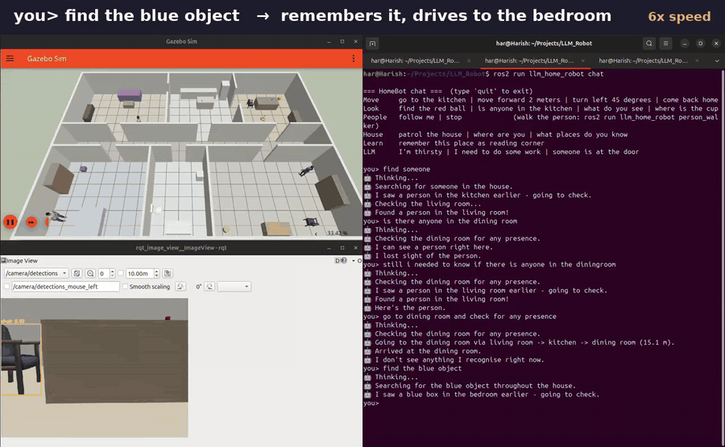
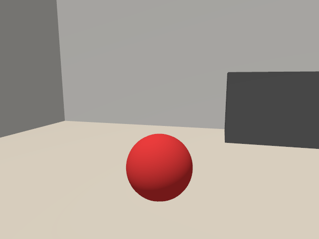
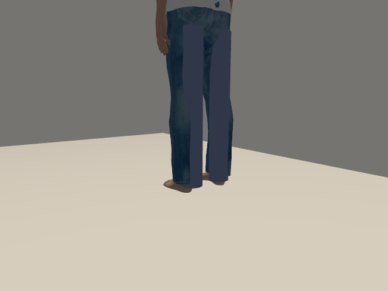
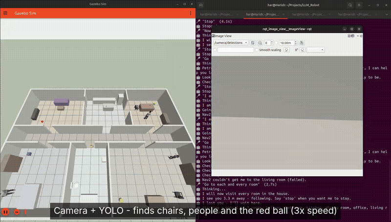
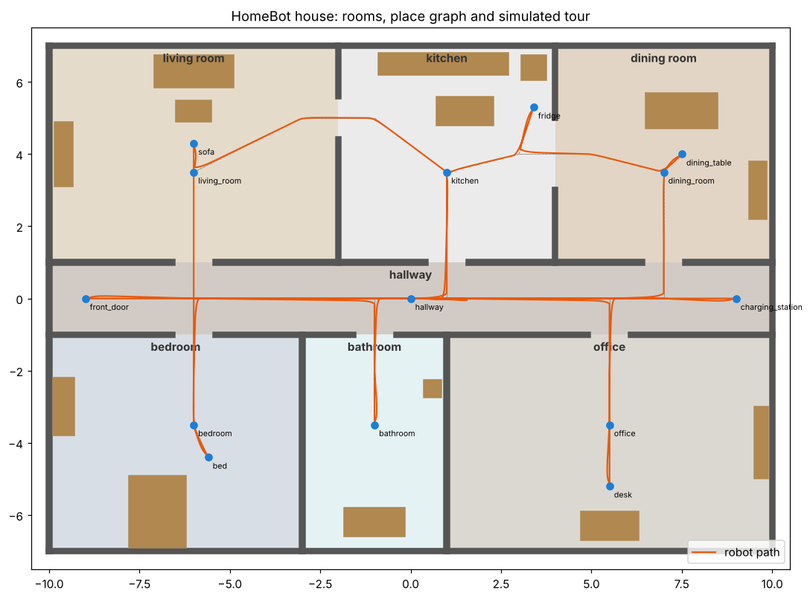
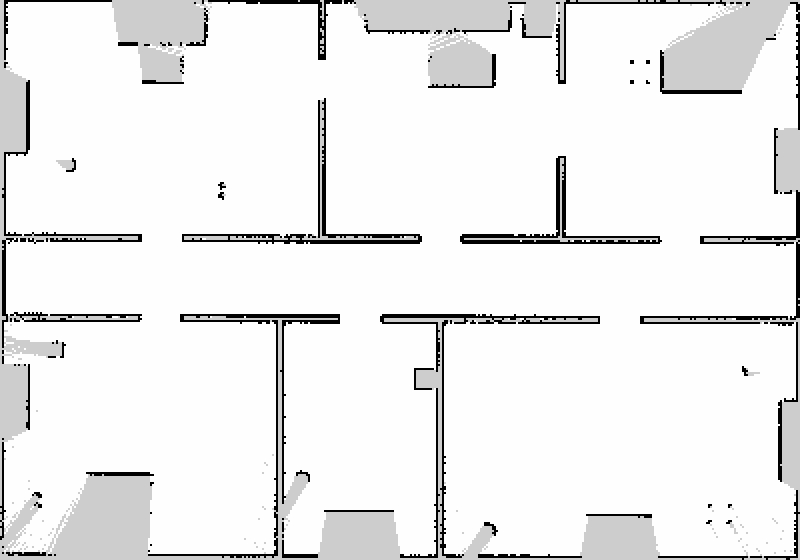
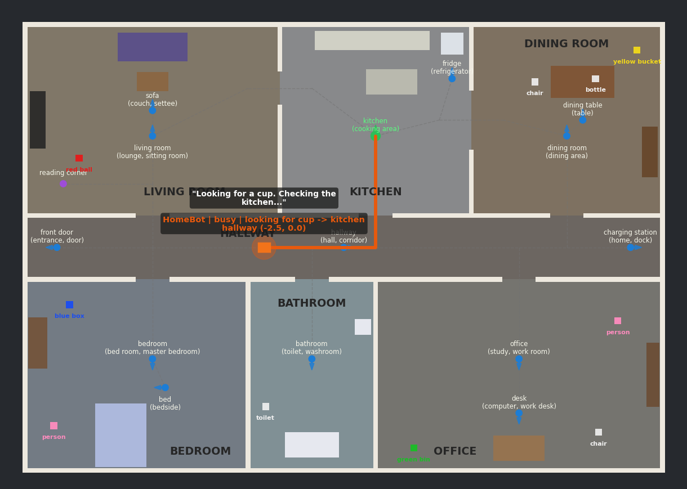

<h1 align="center">🤖 LLM Robot: a home robot you talk to</h1>

<p align="center">
  <b>ROS 2 Jazzy · Gazebo Harmonic · Nav2 · SLAM Toolbox · YOLO11 · Whisper · Ollama (Qwen 2.5)</b>
</p>

<p align="center">
  Type or say things like <i>"go to the kitchen"</i>, <i>"find the blue object"</i>, <i>"is anyone in the dining room?"</i>,
  <i>"follow me"</i> or <i>"I'm thirsty"</i>. A local LLM turns them into robot actions, and the robot drives around
  a 7-room simulated house, searching rooms with its camera.
</p>

<p align="center">
  
</p>

<p align="center"><i>Real run, sped up. Left: Gazebo and the robot's camera with YOLO / colour boxes. Right: the chat.
<a href="docs/demo_find.mp4">▶ Full demo video (MP4)</a></i></p>

---

## Demos

| What the camera sees during "find the red ball" | …and during "find someone" (YOLO) |
|---|---|
|  |  |

| Video | Shows |
|---|---|
| [▶ Finding people and objects](docs/demo_find.mp4) | "find someone", "find the blue object", "find the green object" |
| [▶ Chat commands](docs/videos/1_chat_commands.mp4) | going to places, moving, multi-step commands, learning a place |
| [▶ Follow me](docs/videos/2_follow_me.mp4) | the robot follows a walking person through doorways |
| [▶ Camera search](docs/videos/3_camera_find.mp4) | YOLO and colour detection while searching rooms |

<p align="center"></p>

| The house and a full tour of all 14 places | Map built by SLAM during "patrol the house" |
|---|---|
|  |  |



## What it does

| | |
|---|---|
| 🗣️ **Plain-English commands** | Every command goes to a local LLM (Qwen 2.5 3B via Ollama), which returns JSON actions, for example `"I'm thirsty"` → `goto fridge`. The actions are checked against a fixed list of actions and known places before the robot moves. A rule parser takes over if the LLM is offline. |
| 🏠 **Knows the house** | 20 × 14 m house with a living room, kitchen, dining room, hallway, bedroom, bathroom and office. It has 14 named places with aliases ("lounge", "loo", "fridge") and a doorway graph for routing, and it learns new places on request. |
| 📷 **Finds things** | The camera runs YOLO11 (people, chairs, cups and more) plus a colour detector. *"Find the green object"* checks the robot's memory first, then searches the most likely rooms, spins to look and drives up to the object. Everything it sees is placed on the map and remembered. |
| 🚶 **Follows you** | A lidar person tracker ignores walls and furniture, so it locks onto the person, not the sofa. It follows through doorways at about 0.9 m. |
| 🧭 **Navigation** | Uses a simple doorway-to-doorway driver by default, or **Nav2** (AMCL, or live **SLAM** with slam_toolbox) with `nav:=nav2`. |
| 🎤 **Voice** | Uses Whisper (faster-whisper, offline) with voice-activity detection, an optional wake word and spoken replies. |
| 📊 **RViz** | Shows room and place labels, the planned route, the camera with detection boxes, remembered objects and the robot's status. You can click a place to send the robot there. |

### Two versions

| | Launch | Includes |
|---|---|---|
| **v1: command robot** | `ros2 launch llm_home_robot v1_chat.launch.py` | house, robot, navigation, chat/voice/LLM commands |
| **v2: full robot** | `ros2 launch llm_home_robot v2_full.launch.py` | v1 + camera, YOLO, object search and memory, people models, follow-me (`nav:=nav2 slam:=true` for Nav2 + SLAM) |

## How it works

```
 🎤 voice ─┐
           ▼
 chat ─▶ /robot/command ─▶ interpreter ─▶ /robot/actions ─▶ executor ─▶ /cmd_vel ─▶ Gazebo
                           │ LLM → JSON       [{"type":"find",   │  ▲
                           │ validate()        "object":"cup"}]  │  │ /robot/detections
                           └ rules (backup)                      │  │
                                                                 │  perception (YOLO11 + colour)
                                     graph driver / Nav2 ◀───────┤        ▲
                                                                 │     /camera/image
                                    /robot/reply ─▶ chat, voice, RViz
```

**The LLM never drives the robot directly.** It can only pick from a fixed list of actions (`goto`, `move`, `turn`, `find`, `follow`, `patrol`, …), and `validate()` rejects unknown places or actions and clamps distances. `stop` skips the LLM and acts instantly.

```text
you> find the blue object
🤖 Thinking...
🤖 Searching for the blue object throughout the house.
🤖 I saw a blue box in the bedroom earlier - going to check.
🤖 Found a blue box in the bedroom!
```

**LLM check** (`python3 tools/eval_llm.py`, 17 everyday requests, no simulator needed):

| Model | Score |
|---|---|
| qwen2.5:3b (default) | 15 / 17 |
| llama3.2:3b | 15 / 17 |

## Quick start

**Needs:** Ubuntu 24.04 and ROS 2 Jazzy.

```bash
# 1. Dependencies
sudo apt install ros-jazzy-ros-gz ros-jazzy-robot-state-publisher ros-jazzy-navigation2 \
                 ros-jazzy-slam-toolbox python3-yaml python3-opencv python3-pip
curl -fsSL https://ollama.com/install.sh | sh && ollama pull qwen2.5:3b

# optional: YOLO and voice (CPU-only PyTorch keeps it small)
pip install torch torchvision --index-url https://download.pytorch.org/whl/cpu --break-system-packages
pip install ultralytics "numpy<2" faster-whisper sounddevice --break-system-packages

# 2. Build
mkdir -p ~/LLM_Robot && cd ~/LLM_Robot
git clone https://github.com/harishvenky29/LLM_Robot.git llm_home_robot
colcon build --symlink-install
source install/setup.bash
```

**Run it** (a new terminal for each line, each one starting with `source install/setup.bash`):

```bash
ollama serve                                         # 1: the LLM
ros2 launch llm_home_robot v2_full.launch.py         # 2: Gazebo + robot + camera + RViz
ros2 run llm_home_robot chat                         # 3: type commands  (or: ros2 run llm_home_robot voice)
ros2 run rqt_image_view rqt_image_view /camera/detections   # 4: optional: watch what YOLO sees
ros2 run llm_home_robot person_walker                # 5: optional: make the person walk (for "follow me")
```

## Try these

| | |
|---|---|
| Move | `move forward 2 meters` · `turn left 45 degrees` · `turn around` · `back up a bit` |
| Go places | `go to the kitchen` · `take me to the loo` · `go home` |
| Find | `find someone` · `find the blue object` · `is anyone in the dining room?` · `find the red ball` |
| Memory | `where is the cup?` · `what do you see?` |
| People | `follow me` · `stop` |
| Multi-step | `go to the bedroom, wait 5 seconds and come back` |
| Indirect (LLM) | `I'm thirsty` → fridge · `someone is at the door` → front door · `I want to watch TV` → sofa |
| Learn | `remember this place as reading corner` → later `go to reading corner` |
| House | `patrol the house` (visits every room; with SLAM it maps the house too) |

Objects to find: **red ball** (living room), **blue box** (bedroom), **green bin** (office), **yellow bucket** (dining room), plus YOLO-detected **people**, **chairs**, a **toilet** and a **cup**.

## Launch options

| Option | |
|---|---|
| `nav:=nav2` | Nav2 + AMCL on the saved map |
| `nav:=nav2 slam:=true` | Nav2 + live SLAM |
| `llm_model:=llama3.2:3b` | a different Ollama model |
| `llm_backend:=none` | rule parser only, no LLM |
| `detector:=colour` | colour detector only, no YOLO |
| `props:=false` | skip the Gazebo Fuel people and furniture models (offline) |
| `rviz:=false` · `headless:=true` | lighter runs |

## Project layout

```
llm_home_robot/
├── launch/          v1_chat, v2_full, home (all options), nav2
├── config/          places.yaml (places + aliases + routes), Nav2 / SLAM params, bridge, RViz
├── llm_home_robot/
│   ├── llm_client.py         # prompt + Ollama / Claude call → JSON actions
│   ├── interpreter_node.py   # text → actions (LLM, rules as backup)
│   ├── command_parser.py     # rule parser + validate()
│   ├── executor_node.py      # actions → motion, find, follow, patrol, memory
│   ├── perception.py         # YOLO11 + colour detector, camera geometry, object memory
│   ├── perception_node.py    # camera → /robot/detections
│   ├── follow.py             # lidar person tracker
│   ├── voice_node.py         # mic → Whisper → command, replies → speech
│   ├── house_layout.py       # one source for walls, furniture and objects
│   └── chat_node.py, person_node.py, viz_node.py
├── urdf/home_bot.urdf        # diff drive + 360° lidar + RGB camera
├── worlds/big_home.sdf       # generated by tools/generate_world.py
├── demos/                    # scripts for recording the demo videos
└── test/                     # 118 unit tests (no ROS needed)
```

## Tests

```bash
python3 -m pytest test/ -q      # 118 passed: parser, routing, perception, memory, follow tracker, voice
python3 tools/eval_llm.py       # LLM accuracy on 17 everyday requests
```

## Troubleshooting

| Problem | Fix |
|---|---|
| `Package 'llm_home_robot' not found` | `source install/setup.bash` in every terminal |
| Replies say "rules" instead of "LLM" | start `ollama serve` and `ollama pull qwen2.5:3b` |
| "YOLO unavailable" | `pip install ultralytics "numpy<2" --break-system-packages` (colour objects still work) |
| No people or chairs in Gazebo | the first launch downloads them from Gazebo Fuel and needs internet once |
| Voice: `libcublas` error | already handled: Whisper runs on the CPU by default |
| Simulation is slow | `rviz:=false` or `detector:=colour` |

## More detail

Full reference (all topics, RViz legend, customising the house): [docs/DETAILS.md](docs/DETAILS.md) · Demo recording scripts: [demos/](demos/README.md)

## Author

**Harish Venkatesan M R**, MSc Intelligent Robotics (University of York)
[GitHub](https://github.com/harishvenky29) · [LinkedIn](https://www.linkedin.com/in/harish-venkatesan-m-r-833173191)

## License

MIT, see [LICENSE](LICENSE).
